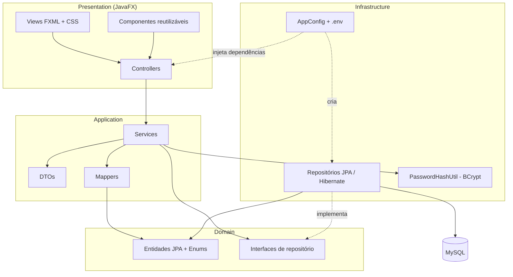

# 💳 Credit Card Module

Aplicação desktop de gestão de cartões de crédito, da solicitação com limite pré-aprovado ao pagamento de faturas, construída em Java 17, JavaFX e JPA/Hibernate com MySQL.


<!-- TODO: gravar um GIF (login → home → fatura → bloqueio de cartão) e salvar em docs/demo.gif -->

## Sobre o projeto

Projeto de estudo desenvolvido em equipe, que simula o módulo de cartão de crédito de um banco digital. O usuário solicita um cartão, recebe um limite pré-aprovado calculado a partir da renda, acompanha as faturas e gerencia o cartão (limite, vencimento, bloqueio e senha) por uma interface desktop.

O foco do projeto foi praticar arquitetura em camadas, persistência com JPA, testes unitários e trabalho colaborativo com branches de feature e merge requests.

## Funcionalidades

- **Login** por CPF e senha (senha armazenada com hash BCrypt).
- **Solicitação de cartão**: escolha entre os tipos Gold, Internacional, Infinite e Platinum, com cálculo de limite pré-aprovado a partir da renda mensal e geração de número, CVV e validade.
- **Home** com carrossel dos cartões do usuário, status do cartão e transações recentes.
- **Ajuste de limite e dia de vencimento**, com reajuste automático das faturas futuras.
- **Bloqueio e desbloqueio temporário** do cartão, com validação de titularidade e senha.
- **Troca de senha do cartão** (4 dígitos), exigindo a senha de login.
- **Faturas**: linha do tempo com fatura anterior, atual e próxima, detalhamento das parcelas de compras e cálculo do limite disponível.
- **Pagamento e antecipação de fatura** via PIX, boleto, débito ou crédito, com liberação imediata do limite.
- **Exportação da fatura em PDF.**

## Tecnologias

| Camada | Tecnologias |
|---|---|
| Linguagem / Build | Java 17, Maven |
| Interface | JavaFX 22 (FXML + CSS), FontAwesomeFX |
| Persistência | Jakarta Persistence (JPA) 3.1, Hibernate ORM 6.5 |
| Banco de dados | MySQL 8 |
| Segurança | Spring Security Crypto (BCrypt) |
| Utilitários | Lombok, dotenv-java, iText (PDF) |
| Testes | JUnit 5, Mockito |
| Qualidade | Checkstyle |

## Arquitetura

O código é organizado em camadas, com as regras de negócio separadas da interface e da persistência. As interfaces de repositório ficam no domínio e as implementações JPA ficam na infraestrutura. A classe `AppConfig` atua como *composition root*: cria o `EntityManager`, os repositórios e os serviços e os entrega aos controllers.



**Padrões utilizados:** arquitetura em camadas, Repository, Service, DTO + Mapper, Singleton e Builder.

```
src/main/java/.../
├── domain/          # entidades, enums e interfaces de repositório
├── application/     # serviços, DTOs, mappers e sessão
├── infrastructure/  # repositórios JPA, configuração e utilitários
└── presentation/    # controllers, componentes e contexto de navegação
src/main/resources/  # telas FXML, CSS, imagens e persistence.xml
```

## Como executar

### Pré-requisitos

- JDK 17
- Maven 3.9+
- MySQL 8 em execução

> **Sobre a dependência `commons-module`:** o projeto depende do `commons-module`, uma biblioteca compartilhada da equipe (responsável pela navegação entre telas) hospedada em um registry Maven privado. Sem acesso a ela, o projeto não compila. Mesmo assim, todo o código deste módulo está disponível aqui para leitura e avaliação.

### 1. Configure o banco

Crie um banco vazio no MySQL. As tabelas são criadas automaticamente pelo Hibernate (`hbm2ddl.auto=update`) na primeira execução.

```sql
CREATE DATABASE credit_card;
```

### 2. Crie o arquivo `.env` na raiz do projeto

```env
DB_HOST=localhost
DB_PORT=3306
DB_NAME=credit_card
DB_USER=seu_usuario
DB_PASSWORD=sua_senha
```

> O arquivo `.env` é obrigatório: a aplicação não inicia sem ele.

### 3. Compile e execute

```bash
mvn clean compile
mvn javafx:run
```

<!-- TODO: explicar como obter um primeiro acesso (o login é feito com o CPF e a senha informados ao solicitar um cartão pela tela "Solicitar cartão"?). -->

## Como rodar os testes

```bash
mvn test
```

Os testes unitários usam JUnit 5 e Mockito (não precisam de banco de dados) e cobrem:

- `CreditCardServiceImplTest`: troca de senha do cartão (validações de entrada, titularidade, senha de login e sucesso).
- `InvoiceServiceImplTest`: pagamento de fatura, liberação de limite e listagem de faturas.

> O Checkstyle roda na fase `validate`, então violações de estilo interrompem o build antes dos testes.

## Minha contribuição

Atuei principalmente no **domínio do cartão de crédito** e nas funcionalidades de **gestão e segurança do cartão**:

- **Projetei** a entidade `CreditCard` e sua camada de acesso a dados: repositório, DTOs e o `CreditCardMapper`.
- **Implementei** o ajuste de limite e do dia de vencimento, incluindo o reajuste automático das faturas futuras (nova consulta no `InvoiceRepository`) e a validação por senha.
- **Implementei** o bloqueio e desbloqueio temporário do cartão, com regras de transição de status (ativo ↔ bloqueado) e verificação de titularidade.
- **Implementei** a troca de senha do cartão com hash BCrypt e validação da senha de login, e **escrevi** os 7 testes unitários dessa funcionalidade com JUnit 5 e Mockito.
- **Corrigi** a busca e o mapeamento de detalhes de fatura no `InvoiceService`.
- **Ajustei** a configuração do Checkstyle e **revisei e integrei** merge requests de features da equipe na branch de desenvolvimento.

<!-- TODO: complementar com contribuições que não aparecem no git (ex.: telas que você desenhou, revisões de código, organização das tarefas). -->

## Equipe

- Rodrigo Arraes
- Amaury Magno
- David Vida
- Hudson <!-- TODO: sobrenome (commits como "HudsonSilv2") -->
- Joaquin Arrazola
- Miguel Montalvo
- Mikael David <!-- TODO: confirmar se "Mikael Lopes" nos commits é a mesma pessoa -->

<!-- TODO: adicionar links de GitHub/LinkedIn dos integrantes, se desejar. -->
